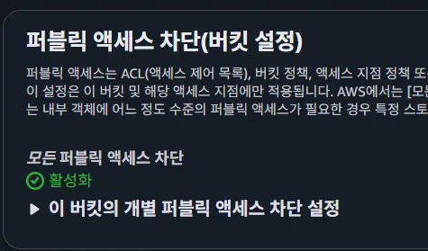

2. 프로젝트에서 사용하는 외부 서비스 정보를 정리한 문서

## 1. Clova

### 1.1 계정 생성

네이버 클라우드 플랫폼 계정 생성 및 로그인

### 1.2 서비스 선택 및 이용 신청

서비스 선택 - AI 서비스 - OCR

특화 OCR 선택

도메인 등록 및 이용신청 (영수증)

### 1.3 키 발급 및 이용

secret key 이용하여 API 사용

참고 링크 : [https://sooeun67.github.io/data science/naver-clova-receipt-ocr/](https://sooeun67.github.io/data%20science/naver-clova-receipt-ocr/)

---

## 2. S3

1. 이미지 저장을 위한 S3 버킷 설정 필요
    1. 퍼블릭 엑세스 차단

        
    2. 리전 설정: 아시아 태평양(서울) ap-northeast-2
    3. 리소스 이름: zzik-picture
    4. 기본 암호화 편집:
        .png)
2. nft썸네일 설정을 위한 S3 버킷 설정 필요
    1. 퍼블릭 엑세스 차단 **비활성화**
        
        .png)
        
    2. 리전 설정: 아시아 태평양(서울) ap-northeast-2
    3. 리소스 이름: zzik-picture
    4. 기본 암호화 편집:
        
        .png)
        
    5. 파일 등록:
        - zzikzzik.png
            
            .png)
            
3. IAM 계정 생성 및 권한 및 액세스 키 등록
    1. 이름: spring-s3-uploader
    2. 권한 : AmazonS3FullAccess 등록
    3. 액세스키 생성 후, 해당 엑세스키와 시크릿 키를 BE전용 .env의 `S3_ACCESS_KEY` , `S3_SECRET_ACCESS_KEY` 에 각각 등록

---

## 3. 싸피 금융망 서비스

- 이체, 송금, 계좌신설 등이 가능한 모의 금융망api를 사용하였다.

---

## 4. 블록체인

**2.1 블록체인 지갑 및 네트워크 설정**

**관리자 지갑 생성**

1. **MetaMask** 또는 **Web3 지갑** 생성
2. **Private Key(개인키)** 추출
    ◦ 서비스 서버가 트랜잭션 대납(Gas Fee) 및 서명을 수행하기 위해 필요
    ◦ 지갑 주소: `<Admin Wallet Address>`
    ◦ Private Key: `<Wallet Private Key>`

**네트워크(RPC) 정보 확인**

1. **Polygon (Matic)** 네트워크 사용
2. Infura, Alchemy 또는 Public RPC URL 확보:

| 환경 | 네트워크 | chainid | rpc-url |
| --- | --- | --- | --- |
| 개발/테스트 | Polygon Amoy | 80002 | `https://rpc-amoy.polygon.technology` |
| 실제 | Polygon Mainnet | 137 | `https://polygon-rpc.com` |

**2.2 스마트 컨트랙트 배포**

**TripMemoryNFT 컨트랙트**

1. **Remix IDE** 또는 **Hardhat** 접속
2. `TripMemoryNFT.sol` 컴파일 (ERC-721 기반 스크립트 작성 필요)
3. 관리자 지갑을 사용하여 배포 (Deploy)
4. 배포된 **Contract Address** 복사: `<Deployed Contract Address>`

**2.3 Node.js 업로더 서버 설정 (Arweave/Irys)**

**환경 변수 (.env) 설정**

1. Node.js 프로젝트 루트의 `.env` 파일 생성
2. 다음 변수 설정:

| 변수명 | 설명 | 예시 값 |
| --- | --- | --- |
| `PORT` | 서버 포트 | `4000` |
| `POLYGON_RPC_URL` | Irys 결제용 RPC | `https://polygon-rpc.com` |
| `WALLET_PRIVATE_KEY` | 결제용 지갑 키 | 0xvbgbn…. |

**실행 및 확인**

1. 의존성 설치: `npm install`
2. 서버 실행: `node src/server.js`
3. 헬스 체크: `http://localhost:4000/` (또는 로그 확인)

---

## 5. Kakao OAuth

### 5.1 카카오 개발자 계정 및 앱 생성

### 계정 설정

1. [Kakao Developers](https://developers.kakao.com/) 접속
2. 카카오 계정으로 로그인
3. **내 애플리케이션** → **애플리케이션 추가하기**
4. 앱 이름: ``
5. 사업자명: 개인 또는 팀명 입력

### 5.2 앱 키 확인 및 설정

### 앱 키 확인

1. 생성된 앱 선택 → **앱 키** 메뉴
2. 필요한 키 복사:
    - **REST API 키**: ``
    - **JavaScript 키**:``

### 5.3 플랫폼 등록

### Web 플랫폼 설정

1. **플랫폼** 메뉴 → **Web 플랫폼 등록**
2. 사이트 도메인 추가:

| 환경 | 도메인 | 용도 |
| --- | --- | --- |
| 개발 | `http://localhost:3000` | 로컬 개발 |
| 개발 | `http://localhost:5173` | Vite 개발 서버 |
| 개발 | `http://localhost:8080` | 백엔드 서버 |
| 운영 | `https://zzik.kr`  | 운영 프론트엔드 |
| 운영 | `https://api.zzik.kr` | 운영 백엔드 |

### 1.4 Redirect URI 설정

### 카카오 로그인 설정

1. **제품 설정** → **카카오 로그인** 활성화
2. **Redirect URI** 등록: backend 및 frontend

### 1.5 동의 항목 설정

### 필수 동의 항목

1. **동의 항목** 메뉴
2. 다음 항목 설정:

| 항목 | 설정 | 설명 |
| --- | --- | --- |
| 프로필 정보 | 필수 동의 | 닉네임, 프로필 사진 |
| 카카오계정(이메일) | 필수 동의 | 사용자 식별 |

---

## 6. Google Map

### 6.1 사용중인 API

1. Google Maps JavaScript API : 지도 표시, 마커 표시, 경로선 표시
2. Google Places API (New) : 장소 텍스트 검색

### 6.2 API 키 설정

1. Google Cloud Console 접속
2. 프로젝트 생성 또는 선택
3. Maps JavaScript API, Places API (new) 활성 화
4. API 키 생성
5. 환경 변수에 추가 `VITE_GOOGLE_MAP_KEY = AIzaSy...`

---

## 7. Naver Map

### 7.1 사용중인 API

1. **Naver Maps API v3** : 지도 표시, 마커 표시, 경로 표시
2. **Geocoding API** : 주소-좌표 변환 (선택적)
3. **Reverse Geocoding API** : 좌표-주소 변환 (선택적)

### 7.2 네이버 클라우드 플랫폼 계정 생성

1. [네이버 클라우드 플랫폼](https://www.ncloud.com/) 접속
2. 네이버 계정으로 로그인 또는 회원가입
3. 본인인증 및 결제수단 등록 (필수)

### 7.3 애플리케이션 등록 및 API 키 발급

#### 애플리케이션 등록

1. [네이버 클라우드 플랫폼 콘솔](https://console.ncloud.com/) 접속
2. **AI·NAVER API** → **Application** 메뉴 이동
3. **Application 등록** 클릭
4. 애플리케이션 정보 입력:
   - 애플리케이션 이름: `zzikgoga` (또는 프로젝트명)
   - Service 선택: **Maps** 체크

#### API 이용 신청

1. 등록한 애플리케이션 선택
2. **인증 정보** 탭에서 다음 확인:
   - **Client ID**: 애플리케이션 식별자
   - **Client Secret**: 인증용 비밀 키
3. **Web Dynamic Map** 사용 설정

### 7.4 서비스 환경 설정

#### Web Dynamic Map 설정

1. 애플리케이션 상세 페이지 → **Web Dynamic Map** 탭
2. **Web 서비스 URL** 등록:

| 환경 | 서비스 URL | 용도 |
| --- | --- | --- |
| 개발 | `http://localhost:5173/` | Vite 개발 서버 |
| 개발 | `http://localhost:3000/` | 로컬 개발 |
| 운영 | `https://zzik.kr/` | 운영 프론트엔드 |

**주의사항**:
- 등록하지 않은 URL에서는 API 호출이 거부됩니다.
- 포트번호까지 정확히 일치해야 합니다.
- HTTPS와 HTTP는 별도로 등록 필요

### 7.5 환경 변수 설정

#### 프론트엔드 (.env)

```bash
# Naver Map API
VITE_NAVER_MAP_CLIENT_ID=your_naver_client_id
VITE_NAVER_MAP_CLIENT_SECRET=your_naver_client_secret
```

#### CRDT 서버 (.env)

CRDT 서버에서 Geocoding/Reverse Geocoding 사용 시:

```bash
# Naver Map API Configuration
NAVER_MAP_CLIENT_ID=your_naver_client_id
NAVER_MAP_CLIENT_SECRET=your_naver_client_secret
```
---

**문서 버전**: 1.1
**최종 수정일**: 2025-11-20
**작성자**: SSAFY 13기 자율 프로젝트 102팀